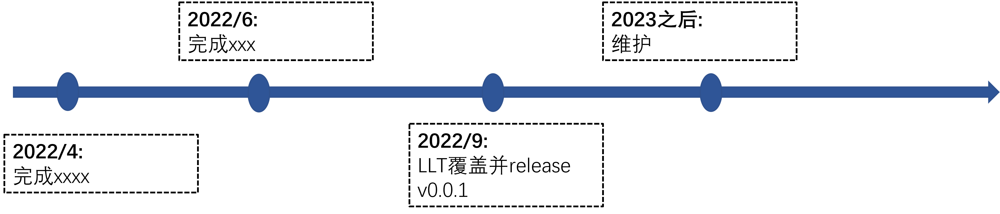
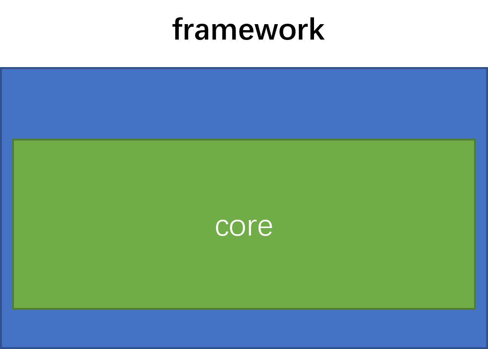

<div align="center">
<h1>oauth4cj</h1>
</div>

<p align="center">


</p>

## 介绍

OAuth 协议为用户资源的授权提供了一个安全的、开放而又简易的标准。与以往的授权方式不同之处是 OAuth 的授权不会使第三方触及到用户的帐号信息，即第三方无需使用用户的用户名与密码就可以申请获得该用户资源的授权，因此 OAuth 是安全的。OAuth 是 Open Authorization 的简写。

代码参考:
1. https://github.com/scribejava/scribejava


### 特性

- 🚀 授权码模式授权

- 🚀 简化模式授权

- 💪 密码模式授权

- 🛠️ 客户端模式授权

### 路线

<p align="center">

</p>
路线图roadmap在 doc/framework-roadmap-logo.pptx 中有源文件。


## 软件架构

### 架构图

<p align="center">

</p>

架构图文字说明，包括模块说明、架构层次等详细说明。

### 源码目录

```shell
.
├── README.md
├── doc
│   ├── assets
│   ├── cjcov
│   ├── design.md
│   └── xxx_lib.md
├── src
│   └── Template.cj
└── test
    ├── HLT
    ├── LLT
    └── UT
```

- `doc`  文档目录，用于存放设计、API接口等文档
- `src`  源码目录
- `test` 测试目录

### 接口说明

主要类和函数接口说明详见 [feature_api](./doc/feature_api.md)


## 使用说明

### 编译构建

描述具体的编译过程：

```shell
git clone https://gitee.com/HW-PLLab/oauth.git       ---> 拉取代码
git clone https://gitee.com/HW-PLLab/testJekins.git  ---> 拉取编译脚本
cd oauth4cj                                          ---> 进入到oauth4cj目录下
cp -r ../testJekins/src/ci_test .                    ---> 将ci_test复制到oauth4cj的根目录
python3 ci_test/main.py build                        ---> 编译
```

### 功能示例
#### xxx 功能示例

功能示例描述:

示例代码如下：

```cangjie
import xxx.*
main() {
 xxxx
}
```

执行结果如下：

```shell
xxx
```

#### xxxx 功能示例

功能示例描述:

示例代码如下：

```cangjie
import xxx.*
main() {
 xxxx
}
```

执行结果如下：

```shell
xxx
```

## 开源协议
The MIT License

## 参与贡献

欢迎给我们提交PR，欢迎给我们提交Issue，欢迎参与任何形式的贡献。