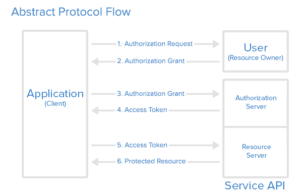

<div align="center">
<h1>oauth4cj</h1>
</div>

<p align="center">


</p>

## 介绍

OAuth4cj 支持协议 OAuth1.0 和 OAuth2.0，允许第三方程序通过访问令牌访问受保护的资源，而无需暴露用户的凭据。支持授权码模式，简化模式，密码模式，客户端模式四种模式。

### 特性

- 💡 授权码模式授权

- 🚀 简化模式授权

- 💪 密码模式授权

- 🛠️ 客户端模式授权

- 🌍 提供网站授权api封装使用示例

### 支持以下协议和附加功能
- RFC 5849 OAuth 1.0协议，[示例](./test/LLT/RFC/RFC5849/test_oauth10a_service_01.cj) 
- RFC 6749 OAuth 2.0授权框架，授权代码授权授予，[示例](./test/LLT/RFC/RFC6749/github_example_authorization.cj)     
- RFC 6749 OAuth 2.0授权框架，资源所有者密码凭据授权授予，[示例](./test/LLT/RFC/RFC6749/gitee_example_password.cj)     
- RFC 6749 OAuth 2.0授权框架，客户端凭据授权授予，[示例](./test/LLT/RFC/RFC6749/huawei_example_client.cj)     
- RFC 6749 OAuth 2.0授权框架，刷新访问令牌，[示例](./test/LLT/RFC/RFC6749/gitee_example_refresh_access_token.cj)     
- RFC 6750 OAuth 2.0授权框架：承载令牌使用，[示例](./test/LLT/RFC/RFC6750/gitee_example_bearer_token_usage.cj)     
- RFC 7009 OAuth 2.0令牌吊销，[示例](./test/LLT/RFC/RFC7009/weibo_example_revocation.cj)     
- RFC 7636 OAuth公共客户端（PKCE）代码交换的证明密钥，[示例](./test/LLT/RFC/RFC7636/huawei_example_pkce.cj)     
- RFC 8628 OAuth 2.0设备授权授予，[示例](./test/LLT/RFC/RFC8628/huawei_example_device.cj)     

## 软件架构

### 架构图
OAuth2 授权登录流程
<p align="center">

</p>

OAuth 定义了四种角色：

    资源拥有者 (Resource Owner)
    客户端 (Client)
    资源服务器 (Resource Server)
    授权服务器 (Authorization Server)

流程：

    1.用户点击客户端提供的授权请求
    2.客户端请求服务的授权页面呈现给用户，用户点击确认授权后服务端返回授权许可凭证给客户端
    3.客户端通过步骤二接收到的授权许可凭证及在服务端注册的应用信息请求服务端
    4.如果步骤三验证通过服务端则返回 access token 给客户端
    5.客户端通过第四步获取的 access token 请求服务端获取资源
    6.如果服务端校验 access token 成功，则返回指定资源给客户端

### 源码目录

```shell
.
├── doc  
├── src                             --- 源码
└── test
│   ├── HLT                         --- 测试用例
│   └── LLT                         --- 自测用例
├── CHANGELOG.md  
├── gitee_gate.cfg  
├── LICENSE.txt  
├── module.json  
├── README.md  
└── README.OpenSource  
```

- `doc`  文档目录，存放API接口等文档
- `src`  源码目录
- `test` 测试用例目录

### 接口说明

主要类和函数接口说明详见 [feature_api](./doc/feature_api.md)

## 使用说明

### 编译构建
拉取代码和依赖进行编译构建，步骤如下：

#### 1.拉取 oauth4cj 代码，和依赖库 httpclient4cj 的代码

```shell
git clone https://gitcode.com/Cangjie-TPC/oauth4cj.git
cd oauth4cj   # 进入到oauth4cj目录下, 再拉取依赖库                                           
git clone https://gitcode.com/Cangjie-TPC/httpclient4cj.git
```

#### 2.获取四个依赖文件 libcrypto 和 libssl，放到 oauth4cj/lib 目录下
oauth4cj 需要依赖 libcrypto.so 和 libcrypto.so.3 和 libssl.so 和 libssl.so.3 (windows 系统是对应的 xxx.dll)    

##### 2.1 获取路径：
在 https://gitee.com/HW-PLLab/ci_lib.git 的 lib_oauth4cj 分支中，按照环境找包，获取对应依赖文件。

```shell
mkdir lib # 在 oauth4cj 目录下，创建 lib 目录
# 将获取的四个.so/.dll 文件，复制到创建好的oauth4cj/lib 目录下
cp -r so库存放地址/libcrypto.so ./lib
cp -r so库存放地址/libcrypto.so.3 ./lib
cp -r so库存放地址/libssl.so ./lib
cp -r so库存放地址/libssl.so.3 ./lib
```

#### 3.返回到 oauth4cj 目录下进行编译

```shell
cjpm build -V
```

#### 4.编译完成后，将第2步中获得的两个 .so/.dll 文件，再复制到 oauth4cj/build/crypto4cj/ 目录下

### 执行用例
编译用例并执行，步骤如下：

#### 1. 进入 oauth4cj/test/ 目录下创建 tmp 文件夹，然后编译测试用例
```shell
cd oauth4cj/test/
mkdir tmp
cjc -O2 --import-path xxxxx/oauth4cj/build/oauth4cj/.. -L xxxxx/oauth4cj/build/oauth4cj -l oauth4cj_oauth4cj --import-path xxxxx/oauth4cj/build/httpclient4cj/.. -L xxxxx/oauth4cj/build/httpclient4cj -l httpclient4cj_httpclient4cj --import-path xxxxx/oauth4cj/build/crypto4cj/.. -L xxxxx/oauth4cj/build/crypto4cj -l crypto -l crypto4cj_aescj -l crypto4cj_bignumcj -l crypto4cj_dhcj -l crypto4cj_digestcj -l crypto4cj_dsacj -l crypto4cj_eccj -l crypto4cj_hmaccj -l crypto4cj_md5cj -l crypto4cj_rc2cj -l crypto4cj_rc4cj -l crypto4cj_rsacj -l crypto4cj_sha1cj -l crypto4cj_sha224cj -l crypto4cj_sha256cj -l crypto4cj_sha384cj -l crypto4cj_sha512cj -l crypto4cj_symmetrycj -l crypto4cj_utils -l mycrypto  xxxxx/oauth4cj/test/HLT/utils/test_URLEncoder_01.cj xxxxx/oauth4cj/test/HLT//common.cj -o xxxxx/oauth4cj/test/tmp/test.cj.out --test
```

##### 1.1 具体说明

- cjc命令, -O2表示开启优化
```shell
cjc -O2
```
- --import-path 导入oauth库编译出来的库文件地址, 注意地址最后有".."
- -L 导入库文件的完整路径
- 导入多个库,每个库都需要--import-path和 -L

```shell
--import-path xxxxx/oauth4cj/build/oauth4cj/.. -L xxxxx/oauth4cj/build/oauth4cj -l oauth4cj_oauth4cj
--import-path xxxxx/oauth4cj/build/httpclient4cj/.. -L xxxxx/oauth4cj/build/httpclient4cj -l httpclient4cj_httpclient4cj
```
- -l 要导入的具体的包, 用"库名_包名",一般库文件生成时是"lib库名_包名.后缀"的格式
- 导入一个库中有多个包时,用多个 -l
```shell
--import-path xxxxx/oauth4cj/build/crypto4cj/.. -L xxxxx/cj_project/oauth4cj/build/crypto4cj -l crypto -l crypto4cj_aescj -l crypto4cj_bignumcj -l crypto4cj_dhcj -l crypto4cj_digestcj -l crypto4cj_dsacj -l crypto4cj_eccj -l crypto4cj_hmaccj -l crypto4cj_md5cj -l crypto4cj_rc2cj -l crypto4cj_rc4cj -l crypto4cj_rsacj -l crypto4cj_sha1cj -l crypto4cj_sha224cj -l crypto4cj_sha256cj -l crypto4cj_sha384cj -l crypto4cj_sha512cj -l crypto4cj_symmetrycj -l crypto4cj_utils -l mycrypto
```

- 测试用例的完整路径和用例中引入文件的完整路径
- -o 用例编译后输出的位置和名称, .out结尾, 一般使用"用例名称.out"
- --test 用例编译命令结尾
```shell
xxxxx/oauth4cj/test/HLT/utils/test.cj xxxxx/oauth4cj/test/HLT/common.cj -o xxxxx/oauth4cj/test/tmp/test.cj.out --test
```

#### 2. 把编译好的文件复制到 .out 文件下(oauth4cj/test/tmp/) 
- 把oauth4cj/build/oauth4cj/、oauth4cj/build/crypto4cj/、oauth4cj/build/httpclient4cj/ 目录中的文件都复制到 .out 文件位置(oauth4cj/test/tmp/ 中)

#### 3. 进入到.out文件位置，执行用例
- 进入到.out文件位置执行用例
```shell
cd xxxxx/oauth4cj/test/tmp/
```
- windows系统打开cmd,输入.out文件完整名称即可执行
```shell
test.cj.out
```
- Linux系统使用 ./.out文件完整名称
```shell
./test.cj.out
```


### 功能示例

#### 准备授权服务器环境

##### 授权服务器-gitee

```shell
https://gitee.com/api/v5/oauth_doc#/list-item-3
注册gitee账号，打开链接，按照《OAuth说明文档》中【创建应用流程】步骤操作，创建应用，生成 client_id 和 client_secret。
```

##### 授权服务器-华为

```shell
https://developer.huawei.com/consumer/cn/doc/development/HMSCore-Guides/open-platform-oauth-0000001053629189
打开链接，按照《基于OAuth 2.0开放鉴权》中步骤操作，注册为开发者，创建应用，创建凭证，申请授权，生成 client_id 和 client_secret。
```

##### 授权服务器-腾讯

```shell
https://wikinew.open.qq.com/index.html#/iwiki/876832074
打开链接，按照《OAuth2.0开发文档》中步骤操作，注册为开发者，申请 client_id 和 client_secret，添加应用。
```

##### 授权服务器-GitHub

```shell
https://docs.github.com/zh/apps/oauth-apps/building-oauth-apps/creating-an-oauth-app
注册GitHub账号，打开链接，按照《创建 OAuth 应用》中步骤操作，创建应用，生成 client_id 和 client_secret。
```

##### 授权服务器-微博

```shell
https://open.weibo.com/wiki/%E6%96%B0%E6%89%8B%E6%8C%87%E5%8D%97
打开链接，参考文档中操作流程，注册为开发者，创建应用，生成 App Key(client_id) 和 App Secret(client_secret)。
```

#### 授权码模式授权

功能示例描述:
通过客户端的后台服务器，与服务提供商的认证服务进行互动;通过授权服务器作为中介来获取，授权认证的过程也是资源所有者直接通过授权服务器进行身份认证。

示例代码如下（gitee为例）：

```cangjie
import std.random.*
import std.collection.*
public import oauth4cj.*

main() {
    //将这些替换为在【授权服务器-gitee】中生成的 client_id 和 client_secret
    let clientId: String = "your client id"
    let clientSecret: String = "your client secret"
    //替换成自己需要的权限范围
    //此授权范围是在【授权服务器-gitee】成功创建的应用中对应的权限描述，多个权限用空格隔开
    let SCOP: String = "user_info emails"
    let NETWORK_NAME: String = "Gitee"
    //替换成自己需要请求的，受保护的资源的链接
    //授权成功拿到访问令牌后，准备请求的受保护的资源的链接
    let PROTECTED_RESOURCE_URL: String = "https://gitee.com/api/v5/emails"
    let m: Random = Random()
    m.seed = 3
    let c: UInt32 = m.nextUInt32()
    let redirect_uri="" //设置回调url{redirect_uri}，用于后面获取授权码code
    let secretState: String = "secret" + c.toString()
    let service: OAuth20Service = ServiceBuilderOAuth20(clientId).
            setApiSecret(clientSecret).
            setDefaultScope(SCOP).
            setCallback("${redirect_uri}").
            build(GiteeApi.instance())

    //=== Gitee的OAuth工作流 ===

    //1. 获取授权 URL

    //1.1 对授权连接中的配置，进行设置
    let additionalParams: HashMap<String, String> = HashMap<String, String>()
    //通过设置 access_type=offline 以获取刷新令牌
    additionalParams.put("access_type", "offline")
    //强制reget刷新令牌（如果不是第一次询问用户）
    additionalParams.put("prompt", "consent")

    //1.2 生成可以获取授权码的链接
    //授权认证服务器通过回调地址{redirect_uri}将【用户授权码】code 传递给【应用服务器】或者直接在 Webview 中跳转到携带用户授权码的回调地址上，
    //Webview(网页) 直接获取 code 即可。（{redirect_uri}?code=abc&state=xyz)
    let authorizationUrl: String = AuthorizationUrlBuilder(service).
            setState(secretState).
            setAdditionalParams(additionalParams).
            build()
    println("授权URL: " + authorizationUrl)

    //1.3 替换成上一步生成的一次性授权码
    let code: String = "your code"

    //2.获取访问令牌！
    var accessToken: OAuth2AccessToken = service.getAccessToken(code)
    println("(访问令牌-原始响应如下：" + accessToken.getRawResponse() + "')")

    //3.刷新访问令牌...
    accessToken = service.refreshAccessToken(accessToken.getRefreshToken())
    println("(刷新令牌-原始响应如下：" + accessToken.getRawResponse() + "')")

    //4.请求一个受保护的资源！
    let requestUrl: String = PROTECTED_RESOURCE_URL
    let request: OAuth4cjRequest = OAuth4cjRequest(Verb.GET, requestUrl)

    //4.1 请求签名
    service.signRequest(accessToken, request)

    //4.2 调用同步请求执行
    let response: OAuth4cjResponse = service.execute(request)
    println(response.getCode())
    println(response.getBody())
}

/*
 * 准备 OAuth 协议 1.0a 版或者 2.0 版的默认实现：
 * 根据实际需求继承 DefaultApi10a 或者 DefaultApi20，实现抽象方法，覆盖不同的提取器或服务。
 */
public class GiteeApi <: DefaultApi20 {

    protected init() { }

    public static func instance(): GiteeApi {
        return GiteeApi()
    }

    //返回请求类型
    public func getAccessTokenVerb(): Verb {
        return Verb.POST
    }

    //返回接收访问令牌请求的 URL
    public func getAccessTokenEndpoint(): String {
        return "https://gitee.com/oauth/token"
    }

    //返回授权链接
    protected func getAuthorizationBaseUrl(): String {
        return "https://gitee.com/oauth/authorize"
    }

    //指定访问令牌提取器并返回: 用于 OAuth 2.0 的 TokenExtractor 的 JSON 实现
    public func getAccessTokenExtractor(): TokenExtractor<OAuth2AccessToken> {
        return OAuth2AccessTokenJsonExtractor.instance()
    }

    //客户端身份验证: 在请求主体中写入 "client_id" 和 "client_secret" 及其对应的键值对信息
    public func getClientAuthentication(): ClientAuthentication {
        return RequestBodyAuthenticationScheme.instance()
    }

    //承载签名URI查询参数: 请求签名时,添加查询参数 "access_token" 及其对应的键值对信息
    public func getBearerSignature(): BearerSignature {
        return BearerSignatureURIQueryParameter.instance()
    }
}
```

执行结果如下：

```shell
授权URL: https://gitee.com/oauth/authorize?access_type=offline&prompt=consent&response_type=code&client_id=${code&client_id}&redirect_uri=${redirect_uri}&scope=profile&state=secret2356345771
(访问令牌-原始响应如下：{"access_token":"...","token_type":"bearer","expires_in":86400,"refresh_token":"...","scope":"user_info emails","created_at":1686821665}')
(刷新令牌-原始响应如下：{"access_token":"...","token_type":"bearer","expires_in":86400,"refresh_token":"...","scope":"user_info emails","created_at":1686821665}')
200
[{"email":"...","state":"confirmed","scope":["...","..."]}]
```

####  密码模式授权

功能示例描述:
用户需要向客户端提供自己的用户名和密码，客户端使用这些信息向“服务提供商”索要授权。

示例代码如下（gitee为例）：

```cangjie
import std.collection.*
public import oauth4cj.*

main() {
    var test_01 = testPassword_01()
    if (test_01 != 0){
        println(test_01)
        return test_01
    }
    return test_01
}

public func testPassword_01(): Int32 {
    //将"your_username"和"your_password"替换成实际的 gitee 账户名和密码
    let USER_NAME: String = "your_username"
    let PASSWORD: String = "your_password"

    //将这些替换为在【授权服务器-gitee】中生成的 client_id 和 client_secret
    let clientId: String = "your client id"
    let clientSecret: String = "your client secret"

    //替换成自己需要的权限范围
    //此授权范围是在【授权服务器-gitee】成功创建的应用中对应的权限描述，多个权限用空格隔开
    let SCOP: String = "user_info emails"

    let NETWORK_NAME: String = "Gitee"

    //替换成自己需要请求的，受保护的资源的链接
    //授权成功拿到访问令牌后，准备请求的受保护的资源的链接
    let PROTECTED_RESOURCE_URL: String = "https://gitee.com/api/v5/emails"
    let redirect_uri=""//设置回调url{redirect_uri}，用于后面获取授权码code
    let service: OAuth20Service = ServiceBuilderOAuth20(clientId).
            setApiSecret(clientSecret).
            setDefaultScope(SCOP).
            setCallback("${redirect_uri}").
            build(GiteeApi.instance())

    //=== Gitee的OAuth工作流 ===

    //1. 调用密码模式，获取访问令牌！
    let accessToken: OAuth2AccessToken = service.getAccessTokenPasswordGrant(USER_NAME, PASSWORD)
    println("(原始响应如下：" + accessToken.getRawResponse() + "')")

    //2. 请求一个受保护的资源！
    let requestUrl: String = PROTECTED_RESOURCE_URL
    let request: OAuth4cjRequest = OAuth4cjRequest(Verb.GET, requestUrl)

    //2.1 请求签名
    service.signRequest(accessToken, request)

    //2.2 调用同步请求执行
    let response: OAuth4cjResponse = service.execute(request)
    println(response.getCode())
    println(response.getBody())

    return 0
}

/*
 * 准备 OAuth 协议 1.0a 版或者 2.0 版的默认实现：
 * 根据实际需求继承 DefaultApi10a 或者 DefaultApi20，实现抽象方法，覆盖不同的提取器或服务。
 */
public class GiteeApi <: DefaultApi20 {

    protected init() { }

    public static func instance(): GiteeApi {
        return GiteeApi()
    }

    //返回请求类型
    public func getAccessTokenVerb(): Verb {
        return Verb.POST
    }

    //返回接收访问令牌请求的 URL
    public func getAccessTokenEndpoint(): String {
        return "https://gitee.com/oauth/token"
    }

    //返回授权链接
    protected func getAuthorizationBaseUrl(): String {
        return "https://gitee.com/oauth/authorize"
    }

    //指定访问令牌提取器并返回: 用于 OAuth 2.0 的 TokenExtractor 的 JSON 实现
    public func getAccessTokenExtractor(): TokenExtractor<OAuth2AccessToken> {
        return OAuth2AccessTokenJsonExtractor.instance()
    }

    //客户端身份验证: 在请求主体中写入 "client_id" 和 "client_secret" 及其对应的键值对信息
    public func getClientAuthentication(): ClientAuthentication {
        return RequestBodyAuthenticationScheme.instance()
    }

    //承载签名URI查询参数: 请求签名时,添加查询参数 "access_token" 及其对应的键值对信息
    public func getBearerSignature(): BearerSignature {
        return BearerSignatureURIQueryParameter.instance()
    }
}
```

执行结果如下：

```cangjie
(原始响应如下：{"access_token":"...","token_type":"bearer","expires_in":86400,"refresh_token":"...","scope":"user_info emails","created_at":1686821354}')
200
[{"email":"...","state":"confirmed","scope":["...","..."]}]
```

#### 客户端模式授权

功能示例描述:
客户端以自己的名义，而不是以用户的名义，向“服务提供方”进行认证.
即在这种模式下，用户并不需要对客户端授权，用户直接向客户端注册，客户端以自己的名义要求“服务提供商”提供服务。

示例代码如下（华为示例）：

```cangjie
import std.collection.*

public import oauth4cj.*

main() {
    //将这些替换为在【授权服务器-华为】中生成的 client_id 和 client_secret
    let clientId: String = "your client id"
    let clientSecret: String = "your client secret"

    //替换成自己需要的权限范围
    //此授权范围是在【授权服务器-华为】申请的授权，多个权限用空格隔开
    let SCOP: String = "openid profile email"

    //替换成自己需要请求的，受保护的资源的链接
    //授权成功拿到访问令牌后，准备请求的受保护的资源的链接
    let PROTECTED_RESOURCE_URL: String = "https://account.cloud.huawei.com/rest.php?nsp_svc=GOpen.User.getInfo"
    let redirect_uri=""//设置回调url{redirect_uri}，用于后面获取授权码code
    let service: OAuth20Service = ServiceBuilderOAuth20(clientId).
            setApiSecret(clientSecret).
            setDefaultScope(SCOP).
            setCallback("${redirect_uri}").
            build(HuaweiApi.instance())

    //=== 华为的OAuth工作流 ===

    //1. 调用客户端模式，获取访问令牌！
    let accessToken: OAuth2AccessToken = service.getAccessTokenClientCredentialsGrant()
    println("(原始响应如下：" + accessToken.getRawResponse() + "')")

    //2. 请求一个受保护的资源！
    let requestUrl: String = PROTECTED_RESOURCE_URL
    let request: OAuth4cjRequest = OAuth4cjRequest(Verb.POST, requestUrl)

    //2.1 请求签名
    service.signRequest(accessToken, request)

    //2.2 调用同步请求执行
    let response: OAuth4cjResponse = service.execute(request)
    println(response.getCode())
    println(response.getBody())
}

/*
 * 准备 OAuth 协议 1.0a 版或者 2.0 版的默认实现：
 * 根据实际需求继承 DefaultApi10a 或者 DefaultApi20，实现抽象方法，覆盖不同的提取器或服务。
 */
public class HuaweiApi <: DefaultApi20 {

    protected init() { }

    public static func instance(): HuaweiApi {
        return HuaweiApi()
    }

    //返回请求类型
    public func getAccessTokenVerb(): Verb {
        return Verb.POST
    }

    //返回接收访问令牌请求的 URL
    public func getAccessTokenEndpoint(): String {
        return "https://oauth-login.cloud.huawei.com/oauth2/v3/token"
    }

    //返回授权链接
    protected func getAuthorizationBaseUrl(): String {
        return "https://oauth-login.cloud.huawei.com/oauth2/v3/authorize"
    }

    //指定访问令牌提取器并返回: 用于 OAuth 2.0 的 TokenExtractor 的 JSON 实现
    public func getAccessTokenExtractor(): TokenExtractor<OAuth2AccessToken> {
        return OAuth2AccessTokenJsonExtractor.instance()
    }

    //客户端身份验证: 在请求主体中写入 "client_id" 和 "client_secret" 及其对应的键值对信息
    public func getClientAuthentication(): ClientAuthentication {
        return RequestBodyAuthenticationScheme.instance()
    }

    //承载签名URI查询参数: 请求签名时,添加查询参数 "access_token" 及其对应的键值对信息
    public func getBearerSignature(): BearerSignature {
        return BearerSignatureURIQueryParameter.instance()
    }

    //返回指定的, RFC 8628 OAuth 2.0 设备授权授予链接
    public func getDeviceAuthorizationEndpoint(): String {
        return "https://oauth-login.cloud.huawei.com/oauth2/v3/device/code"
    }
}

//返回华为[设备授权授予]授权链接
func getDeviceBaseUrl(userCode: String): String {
    return "https://oauth-login1.cloud.huawei.com/oauth2/v3/device?user_code=${userCode}&lang=zh-cn"
}
```

执行结果如下：

```cangjie
(原始响应如下: {"access_token":"...","token_type":"Bearer","expires_in":3600}')
200
{"displayName":"18*******50","openID":"......","displayNameFlag":1}
```

#### 简化模式授权

功能示例描述:
用于在浏览器中使用脚本语言如JS实现的客户端中，特点:直接在浏览器中向认证服务器申请令牌，跳过了“授权码临时凭证”这个步骤。
其所有的步骤都在浏览器中完成，令牌对访问者是可见的，且客户端不需要认证。

示例代码如下（腾讯为例）：

```cangjie
import std.collection.*

public import oauth4cj.*

main() {
    //将这些替换为在【授权服务器-腾讯】中生成的 client_id 和 client_secret
    let clientId: String = "your client id"
    let clientSecret: String = "your client secret"

    //替换成自己需要的权限范围
    //此授权范围是在【授权服务器-腾讯】添加的应用的授权，多个权限请用逗号隔开
    let SCOP: String = "get_user_info"
    let redirect_uri=""//设置回调url{redirect_uri}，用于后面获取access_token
    let service: OAuth20Service = ServiceBuilderOAuth20(clientId).
            setApiSecret(clientSecret).
            setDefaultScope(SCOP).
            setCallback("${redirect_uri}").
            build(TengxunApi.instance())

    //=== 腾讯的OAuth工作流 ===
    let secretState=""
    //调用简化模式，获取访问令牌！
    let authorizationUrl: String = AuthorizationUrlBuilder(service).
            setState(secretState).
            build()
    println("授权URL: " + authorizationUrl)
}


/*
 * 准备 OAuth 协议 1.0a 版或者 2.0 版的默认实现：
 * 根据实际需求继承 DefaultApi10a 或者 DefaultApi20，实现抽象方法，覆盖不同的提取器或服务。
 */
public class TengxunApi <: DefaultApi20 {

    protected init() { }

    public static func instance(): TengxunApi {
        return TengxunApi()
    }

    //返回请求类型
    public func getAccessTokenVerb(): Verb {
        return Verb.GET
    }

    //返回接收访问令牌请求的 URL--PC网站
    public func getAccessTokenEndpoint(): String {
        return "https://graph.qq.com/oauth2.0/token"
    }

    //返回授权链接--PC网站
    protected func getAuthorizationBaseUrl(): String {
        return "https://graph.qq.com/oauth2.0/authorize"
    }

    //指定访问令牌提取器并返回: 用于 OAuth 2.0 的 TokenExtractor 的 JSON 实现
    public func getAccessTokenExtractor(): TokenExtractor<OAuth2AccessToken> {
        return OAuth2AccessTokenJsonExtractor.instance()
    }

    //客户端身份验证: 在请求主体中写入 "client_id" 和 "client_secret" 及其对应的键值对信息
    public func getClientAuthentication(): ClientAuthentication {
        return RequestBodyAuthenticationScheme.instance()
    }

    //承载签名URI查询参数: 请求签名时,添加查询参数 "access_token" 及其对应的键值对信息
    public func getBearerSignature(): BearerSignature {
        return BearerSignatureURIQueryParameter.instance()
    }
}
```

执行结果如下：

```shell
授权URL: https://graph.qq.com/oauth2.0/authorize?response_type=code&client_id=${client_id}&redirect_uri=${redirect_uri}&scope=get_user_info&state=secret630343
```

调用该 URL 链接，PC网站展示结果如下：

```shell
${redirect_uri}?#access_token=...&expires_in=7776000&state=secret630343
```

## 开源协议
本项目基于 [The MIT License](./LICENSE)，请自由的享受和参与开源。

## 参与贡献

欢迎给我们提交PR，欢迎给我们提交Issue，欢迎参与任何形式的贡献。
